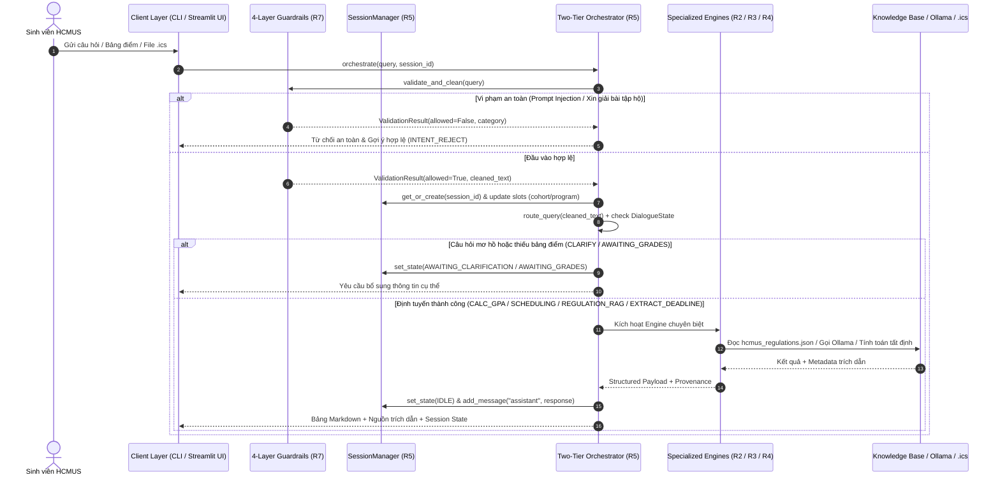
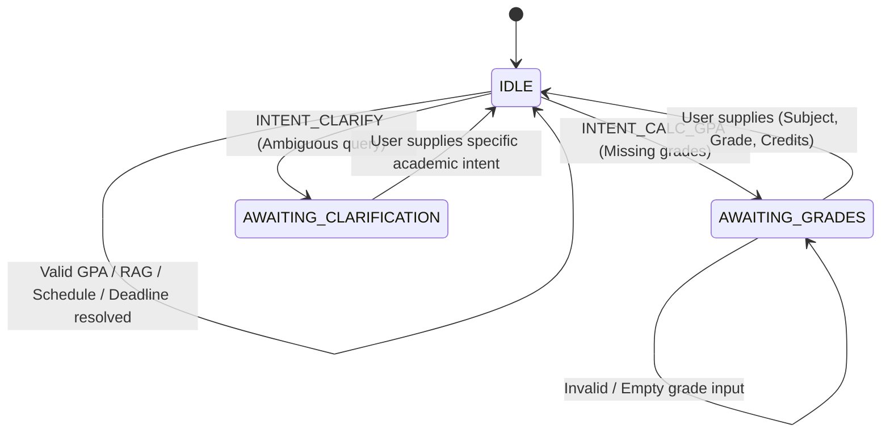

# H.E.R.M.E.S – Architecture & Design Pack (Requirement R5 & Submission Pack 03)
> **HCMUS Educational Resource & Mentoring Expert System**
> CSC10014 – Computational Thinking | FIT, VNU-HCM University of Science (HCMUS)

---

## 1. Architectural Philosophy & Design Principles
* **"AI is one computational component, not the architecture."**
* **Deterministic where correctness matters (R2):** Tính điểm trung bình tích lũy (GPA hệ 10 / hệ 4), kiểm tra ngưỡng cảnh báo học vụ Điều 16 và lập lịch ôn thi (Earliest Deadline First – EDF) bắt buộc thực thi bằng giải thuật tất định 100%, không dùng LLM suy đoán.
* **Provenance-first retrieval where authority matters (R3):** Mọi câu trả lời quy chế phải được trích xuất từ cây dữ liệu 17 văn bản pháp quy chính thức của ĐH KHTN (`data/regulations/hcmus_regulations.json`) kèm số hiệu Quyết định, Điều, Khoản và phạm vi áp dụng.
* **Local AI where unstructured extraction matters (R4):** Chỉ sử dụng mô hình ngôn ngữ lớn cục bộ (**Ollama `qwen2.5:3b` @ `localhost:11434`**) kèm bước kiểm chứng chống ảo giác (*Grounding Verification*) cho tác vụ bóc tách thông báo tự do của giảng viên.
* **Fail-Closed 4-Layer Security (R7):** Mọi truy vấn đi qua bộ lọc 4 lớp trước khi chạm vào Router hoặc các Engine.

---

## 2. C4 Model Architecture Diagrams (3 Levels)
Chi tiết từng cấp độ C4 Model (chuẩn Simon Brown) được tách riêng tại 3 tài liệu chuyên biệt:
1. **Level 1 – System Context Diagram (`C4Context`):** [docs/system_context.md](system_context.md)
2. **Level 2 – Container Diagram (`C4Container`):** [docs/container.md](container.md)
3. **Level 3 – Component Diagram (`C4Component`):** [docs/component.md](component.md)

---

## 3. Sequence & Data-Flow Diagram



---

## 4. Dialogue State Machine Diagram (`src/hermes/router/session.py`)



---

## 5. Core Algorithms Pseudocode (Mã giả Thuật toán Cốt lõi)

### 5.1 Algorithm 1: 4-Layer Security Guardrails (`src/hermes/security/guardrails.py` – Role R7)
```text
ALGORITHM ValidateAndClean(raw_input):
    INPUT: raw_input (string)
    OUTPUT: ValidationResult(allowed, cleaned_text, reason, category)

    1. IF raw_input is NOT string OR Trim(raw_input) is empty:
           RETURN Reject("Empty input", "invalid_input")
    2. IF Length(raw_input) > MAX_INPUT_LENGTH (2000):
           RETURN Reject("Input exceeds 2000 characters", "length_overflow")

    3. // Layer 1: Normalization & De-obfuscation
       cleaned <- RemoveZeroWidthChars(UnicodeNFKC(raw_input))
       compact <- CollapseInterCharacterSpaces(RemoveDiacritics(ToLower(cleaned)))

    4. // Layer 2: Prompt Injection & System Instruction Hijack Detection
       FOR EACH pattern IN PROMPT_INJECTION_PATTERNS:
           IF RegexMatch(pattern, cleaned) OR SubstringMatch(pattern, compact):
               RETURN Reject("Prompt injection detected", "prompt_injection")

    5. // Layer 3: Academic Integrity (Anti-Homework Solving)
       FOR EACH pattern IN ACADEMIC_INTEGRITY_PATTERNS:
           IF RegexMatch(pattern, cleaned) AND NOT IsLegitimateRegulationQuery(cleaned):
               RETURN Reject("Homework/exam solving is prohibited", "academic_integrity")

    6. // Layer 4: Payload & XSS / SQLi Sanitization
       FOR EACH pattern IN MALICIOUS_PAYLOAD_PATTERNS:
           IF RegexMatch(pattern, cleaned):
               RETURN Reject("Unsafe script/SQL payload detected", "malicious_payload")

    7. RETURN Allow(cleaned_text = cleaned)
```

### 5.2 Algorithm 2: Two-Tier Intent Router & Session Orchestrator (`src/hermes/router/orchestrator.py` – Role R5)
```text
ALGORITHM Orchestrate(query, session_id):
    INPUT: query (string), session_id (string)
    OUTPUT: ResponseDict(status, intent, target_engine, response_text, data, provenance)

    1. guard_res <- ValidateAndClean(query)
       IF NOT guard_res.allowed:
           RETURN FormatSafeRejection(guard_res)

    2. session <- SessionManager.GetOrCreate(session_id)
       session.AddMessage("user", guard_res.cleaned_text)
       UpdateCohortAndProgramSlots(session, guard_res.cleaned_text)

    3. // Tier 1: Fast-Path Keyword & Regex Scoring (< 1 ms)
       gpa_score   <- CountMatches(query, GPA_KEYWORDS)
       sched_score <- CountMatches(query, SCHEDULING_KEYWORDS)
       reg_score   <- CountMatches(query, REGULATION_KEYWORDS)
       dl_score    <- CountMatches(query, DEADLINE_KEYWORDS)

    4. // Multi-turn State Resolution
       IF session.state == AWAITING_GRADES AND HasGradeTuples(query):
           intent <- CALC_GPA
       ELSE IF dl_score >= 2 OR Contains(query, "thông báo:") OR Contains(query, ".ics"):
           intent <- EXTRACT_DEADLINE
       ELSE IF Max(gpa_score, sched_score, reg_score) == 0:
           intent <- CLARIFY
       ELSE:
           intent <- ArgMax(CALC_GPA: gpa_score, SCHEDULING: sched_score, REGULATION_RAG: reg_score)

    5. // Dispatch to Specialized Engine
       SWITCH intent:
           CASE CALC_GPA:         RETURN RunAcademicEngine(query, session)
           CASE SCHEDULING:       RETURN RunSchedulerEngine(query, session)
           CASE REGULATION_RAG:   RETURN RunHierarchicalRAG(query, session)
           CASE EXTRACT_DEADLINE: RETURN RunDeadlineExtractor(query, session)
           CASE CLARIFY:          session.SetState(AWAITING_CLARIFICATION); RETURN AskClarification()
```

### 5.3 Algorithm 3: Two-Level Hierarchical RAG with BM25 (`src/hermes/rag/retriever.py` – Role R3)
```text
ALGORITHM HierarchicalBM25Search(query, top_k = 5, k1 = 1.5, b = 0.75):
    INPUT: query (string), top_k (int)
    OUTPUT: Ranked list of regulation chunks with exact provenance

    1. // Level 1: Metadata Tree Pruning (Document Level)
       cohort  <- DetectCohort(query)          // e.g., K21, K22, K23, K24, K25
       program <- DetectProgram(query)         // e.g., Chuẩn, TCTA, Tiên tiến
       major   <- DetectMajor(query)           // e.g., CNTT, Toán tin, Khoa học dữ liệu
       candidate_docs <- FilterValidDocuments(ALL_DOCS, cohort, program, major, exclude_expired=True)

    2. // Level 2: BM25 Probabilistic Ranking + Structural Field Boosting (Chunk Level)
       tokens <- TokenizeWithoutDiacritics(query)
       scores <- EmptyList()
       FOR EACH chunk IN ChunksOf(candidate_docs):
           score <- 0
           dl <- Length(chunk.tokens)
           FOR EACH t IN tokens:
               tf <- TermFrequency(t, chunk.tokens)
               idf <- Log(1 + (N - df[t] + 0.5) / (df[t] + 0.5))
               score <- score + idf * ((tf * (k1 + 1)) / (tf + k1 * (1 - b + b * (dl / avgdl))))
               IF t IN chunk.title_tokens:
                   score <- score + 0.6 * idf  // Title match boost
           IF score >= min_score:
               Append(scores, (score, chunk))

    3. SortDescending(scores)
       RETURN TopK(scores, top_k) WITH Provenance(so_hieu, dieu, khoan, trang, pham_vi)
```

### 5.4 Algorithm 4: Deterministic EDF Exam Scheduler (`src/hermes/engines/scheduler.py` – Role R2)
```text
ALGORITHM ScheduleExamsEDF(exams, daily_hours, start_date):
    INPUT: exams = list of (subject, exam_date, credits, difficulty), daily_hours (float)
    OUTPUT: Conflict-free daily study allocation + urgency weights

    1. // Sort by Earliest Deadline First (EDF), tie-breaking by (credits * difficulty) descending
       min_heap <- PriorityQueue()
       FOR EACH exam IN exams:
           days_left <- Max(1, (exam.exam_date - start_date).days)
           weight <- exam.credits * (1 + 0.25 * exam.difficulty)
           Push(min_heap, key=(days_left, -weight), value=exam)

    2. total_weight <- Sum(exam.weight FOR exam IN exams)
       total_available_hours <- daily_hours * MaxDaysRemaining(exams)

    3. plan <- EmptyList()
       WHILE min_heap is NOT empty:
           exam <- Pop(min_heap)
           allocated_hours <- Round(total_available_hours * (exam.weight / total_weight), 1)
           daily_slice <- Round(allocated_hours / exam.days_left, 1)
           Append(plan, {subject: exam.subject, total_hours: allocated_hours, daily_hours: daily_slice})
       RETURN plan
```

---

## 6. Key Data Schemas & Interface Contracts

### 6.1 Knowledge Base Schema (`data/regulations/hcmus_regulations.json`)
```json
{
  "van_ban": [
    {
      "van_ban_id": "QD_1984_2025_CNTT_TCTA",
      "ten_van_ban": "Quy định chuẩn trình độ ngoại ngữ chương trình TCTA ngành CNTT",
      "so_hieu": "1984/QĐ-KHTN",
      "chuong_trinh": "tăng cường tiếng Anh",
      "nganh": ["Công nghệ thông tin"],
      "khoa_ap_dung": ["K22", "K23", "K24", "K25"],
      "het_hieu_luc": null
    }
  ],
  "chunks": [
    {
      "chunk_id": "1984_d4_k1",
      "van_ban_id": "QD_1984_2025_CNTT_TCTA",
      "dieu": "4",
      "khoan": "1",
      "ten_dieu": "Chuẩn trình độ ngoại ngữ đầu ra",
      "trang_start": 3,
      "text": "Sinh viên đạt một trong các chứng chỉ quốc tế tối thiểu...",
      "chung_chi_toi_thieu": {"IELTS": "6.0", "TOEIC_4KN": "Nghe 400, Đọc 385, Nói 160, Viết 150", "VSTEP": "B2"}
    }
  ]
}
```

### 6.2 Orchestrator Output Contract (`src/hermes/router/orchestrator.py`)
```python
{
    "status": "success" | "blocked" | "needs_info" | "needs_clarification",
    "intent": "CALC_GPA" | "SCHEDULING" | "REGULATION_RAG" | "EXTRACT_DEADLINE" | "CLARIFY" | "REJECT",
    "target_engine": "academic_engine" | "scheduler_engine" | "rag_retriever" | "ai_extractor" | "guardrails" | "clarifier",
    "response_text": str,       # Formatted Markdown response for CLI/Web UI
    "data": dict,               # Structured payload + session_state ("IDLE", "AWAITING_GRADES", etc.)
    "provenance": str | None    # Official document citation (Decision ID, Article, Clause)
}
```
