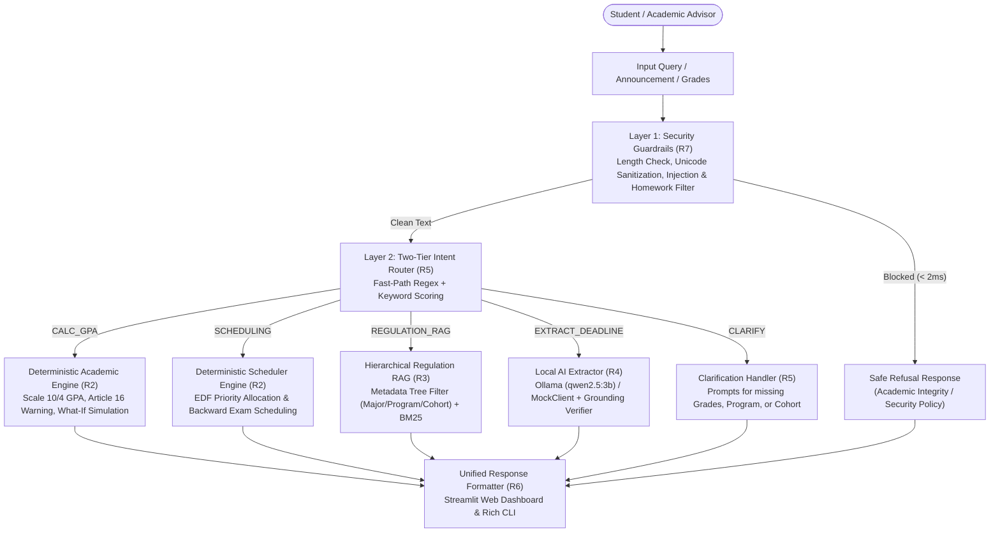
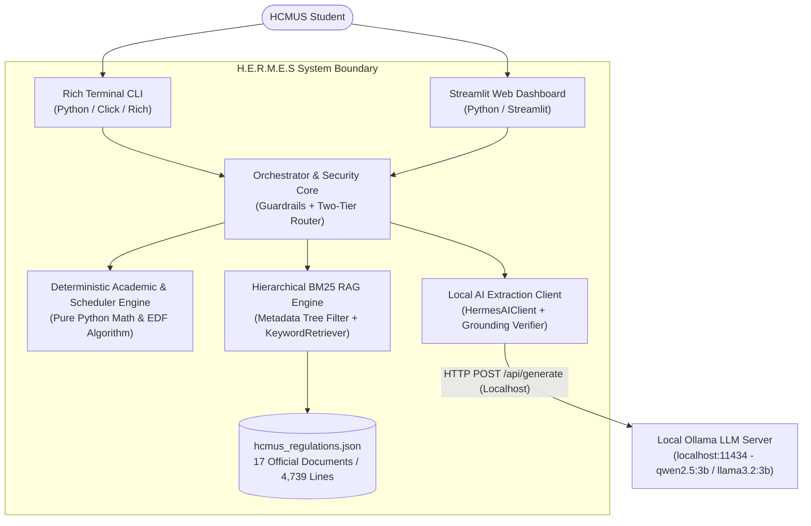
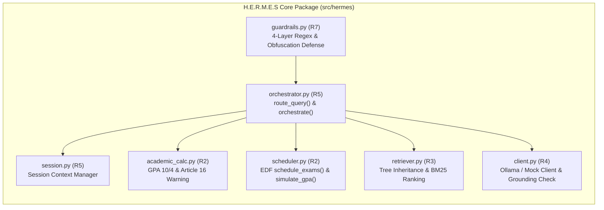

# Project Proposal: H.E.R.M.E.S
**HCMUS Educational Resource & Mentoring Expert System**

* **Course:** CSC10014 – Computational Thinking – Academic Year 2026
* **Institution:** Faculty of Information Technology, VNUHCM - University of Science (HCMUS)
* **Format:** Markdown (Compliant with Notion Proposal Template v2 – Revised per Lecturer Feedback)

---

## 1. Team Information

| No. | Student ID | Full Name | Primary Role | GitHub Account |
| :---: | :---: | :--- | :--- | :--- |
| 1 | 25127331 | Nguyễn Huỳnh Minh Hiếu | Team Leader & System Architect (R1, R5) | `@nhmhieu` |
| 2 | 25127152 | Nghiêm Đình Thuận | Deterministic & Algorithm Lead (R2) | `@thuannghiem11` |
| 3 | 25127552 | Đào Ngọc Vinh | Knowledge Base & RAG Lead (R3) | `@daongocvinh` |
| 4 | 25127471 | Đào Nhật Quân | System Safety & Local AI Lead (R7, R4) | `@dnquan14` |
| 5 | 25127168 | Phan Huỳnh Minh Tuấn | UI/UX & Client Application Lead (R6) | `@phmtuan2522-coder` |
| 6 | 25127176 | Hồ Ngọc Như Ý | QA, Evaluation & Benchmark Lead (R8, R4) | `@hnny712` |

---

## 2. Project Title & Concept

### 2.1 Concept Summary
**H.E.R.M.E.S (HCMUS Educational Resource & Mentoring Expert System)** is an intelligent academic assistant and automated study planning system engineered specifically for undergraduate students at the University of Science, VNU-HCM (HCMUS). It unifies rule-based deterministic computation, verifiable hierarchical legal document retrieval (RAG), and local open-weight language model parsing (**Ollama**) into a cohesive, privacy-preserving dual-path architecture.

### 2.2 Core Problem to Solve
* **Academic Regulation Dispersion & Program-Specific Complexity:** Academic credit bylaws (`1175/QĐ-KHTN`), foreign language exit standards across 4 distinct training programs (`2464/QĐ-KHTN` for Standard/Talented, `1983/QĐ-KHTN` for General English-Enhanced, `1984/QĐ-KHTN` for IT English-Enhanced, and `1985/QĐ-KHTN` for Advanced CS), and academic warning thresholds are scattered across 17+ legal documents totaling hundreds of pages. Students frequently miscalculate GPAs or misread cohort-specific rules.
* **Exam & Deadline Overload:** Freshmen and sophomores struggle to manage 5–7 concurrent courses during condensed 2-week final exam windows, leading to cramming and missed Moodle deadlines.
* **LLM Hallucination, Data Privacy & Security Risks:** Generic cloud chatbots invent fake university guidelines, compute incorrect weighted GPAs, send student academic data to third-party servers, and violate academic integrity by solving student homework.

### 2.3 Definition of Done (DoD)
The project is considered complete when:
1. **Mathematical Accuracy (R2):** 100% precision in GPA computation (scale 10 & scale 4), What-If target GPA simulation, and academic warning classification compliant with Decision `1175/QĐ-KHTN` and Article 16 of the HCMUS Student Handbook.
2. **Provenance-Backed Retrieval (R3):** Every regulation response cites exact formal sources (Document ID, Article, Clause, Page, and applicable Program/Cohort scope).
3. **Fail-Closed Security (R7):** >= 95% defense rate against Vietnamese/English prompt injections, obfuscated attacks, and non-goal requests (refusing to solve homework).
4. **Privacy-Preserving Local AI Integration (R4):** Full support for local open-weight LLMs via **Ollama** (`qwen2.5:3b` / `llama3.2:3b`) alongside an offline deterministic `MockClient`.
5. **End-to-End Interfaces (R6):** Complete functional integration across both Rich Terminal CLI and Streamlit Web Dashboard.
6. **Measurable Benchmark (R8):** Verified on a standardized test suite with before/after iteration evaluation (Routing Accuracy >= 85%, Fast-Path Latency < 20ms) and >450 automated unit tests passing on GitHub Actions CI.

---

## 3. Target Users, Personas & User Journey

### 3.1 Target Users
* **Primary (B2C):** Freshmen and Sophomores at HCMUS (especially FIT, Mathematics, and Natural Sciences) navigating the university credit system, foreign language exit standards, and exam schedules.
* **Secondary (B2B):** Academic Advisors (*Cố vấn học tập*) and Office of Academic Affairs (*Phòng Đào tạo*) staff needing instant, citation-backed regulation lookups.

### 3.2 User Personas
* **Persona A (Nam – 1st Year CS Student):** Overwhelmed by final exam schedules and Moodle announcements; needs automated deadline extraction and conflict-free daily revision planning.
* **Persona B (Mai – 2nd Year IT English-Enhanced Student):** Confused about whether her program requires IELTS 5.0 or 6.0 (`1984/QĐ-KHTN` vs `1985/QĐ-KHTN`) and how many credits she must pass this semester to avoid an academic warning under Article 16.1.a.

### 3.3 User Journey
1. **Input:** Nam asks a regulation/GPA question or pastes an instructor's Moodle announcement.
2. **Safety Check (R7):** 4-layer Guardrails verify input length, strip zero-width/obfuscated tokens, redact secrets, and block prompt injection or homework-solving requests (< 2ms).
3. **Two-Tier Routing (R5):** Fast-path router classifies intent (`CALC_GPA`, `SCHEDULING`, `REGULATION_RAG`, `EXTRACT_DEADLINE`, `CLARIFY`, or `REJECT`) and extracts structured parameters.
4. **Specialized Execution (R2 / R3 / R4):**
   * *Deterministic Engine (R2):* Computes exact Scale-10/Scale-4 GPA, checks Article 16 warning rules, or runs Earliest Deadline First (EDF) exam scheduling.
   * *Hierarchical RAG Engine (R3):* Filters the 17-document JSON tree by major, training program, and cohort before ranking clauses via BM25 + Bigram IDF.
   * *Local Ollama AI Engine (R4):* Extracts structured assignment deadlines (`course_name`, `deadline`, `submission_format`) via local **Ollama** (`qwen2.5:3b`) with strict grounding verification.
5. **Visual Output (R6):** Results rendered via Rich CLI or Streamlit Web UI with color-coded academic status and exact legal citations.

---

## 4. Technology & Platform

* **Programming Language:** Python 3.10+
* **Interfaces (R6):** `Click` & `Rich` (Terminal CLI), `Streamlit` (Interactive Web Dashboard)
* **Algorithms & Logic (R2):** Pure Python exact arithmetic, Priority Queue / Earliest Deadline First (EDF) Interval Scheduling ($O(n \log n)$)
* **Information Retrieval (R3):** Hierarchical Metadata-Aware Document Tree (`hcmus_regulations.json`, 17 official documents, 4,739 lines) + BM25 & Rare Bigram IDF ranking
* **Local AI & Language Model (R4):** **Ollama Local LLM Runtime** (`http://localhost:11434/api/generate`) running open-weight **`qwen2.5:3b`** / **`llama3.2:3b`** (100% local data privacy, zero API cost) + deterministic offline `MockClient` for CI/CD testing
* **Security Guardrails (R7):** Multi-layer Regex sanitization, Unicode normalization, Base64/ROT13/Leetspeak de-obfuscation, and secret redaction
* **DevOps & QA (R8):** GitHub Actions CI (`flake8`, `black`, `pytest`), GitHub Projects Kanban

---

## 5. Related Works & Unique Selling Points (USP)

### 5.1 Survey of Related Works & Existing Solutions
Before designing H.E.R.M.E.S, our team analyzed four categories of existing tools currently used by university students:

1. **Official University Portals & Static PDF Handbooks (HCMUS Portal / P.ĐT Website):**
   * *Strengths:* 100% authoritative legal source.
   * *Limitations:* Regulations are fragmented across 17+ separate PDF decisions (`1175`, `2464`, `1983`, `1984`, `1985`, `2906`, etc.). Students must manually search hundreds of pages and cross-reference cohort tables without interactive calculation or scheduling tools.
2. **Standalone GPA Calculators & Generic Calendar Apps (Excel, Web GPA Tools, Google Calendar, Notion):**
   * *Strengths:* Good at basic arithmetic or storing manual calendar events.
   * *Limitations:* Completely unaware of HCMUS-specific academic bylaws (e.g., failing to flag an academic warning when earned semester credits fall below 7 under Article 16.1.a, or misapplying 10-to-4 scale conversions). Does not automatically allocate study hours backward from exam dates.
3. **Traditional Rule-Based University FAQ Chatbots:**
   * *Strengths:* Safe, predictable canned responses for common admissions questions.
   * *Limitations:* Rigid button-driven menus; cannot parse natural Vietnamese queries containing inline course grades, cannot filter regulations dynamically by cohort/program, and cannot extract deadlines from unstructured instructor announcements.
4. **Generic Cloud-Based LLMs (Public Conversational AI Platforms):**
   * *Strengths:* Fluent natural language understanding.
   * *Limitations:* Severe **hallucinations** on university-specific rules (confusing credit rules across universities), arithmetic errors in weighted GPA calculations, **privacy risks** (sending internal student data to external cloud providers), recurring API subscription costs, and lack of academic integrity guardrails (willingly solving student assignments).

### 5.2 Comparative Matrix & Unique Selling Points (USP)

| Evaluation Criterion | Static PDFs & Portal | Generic GPA / Calendar Apps | Rule-Based FAQ Bots | Generic Cloud LLMs | **H.E.R.M.E.S (Ours)** |
| :--- | :---: | :---: | :---: | :---: | :--- |
| **HCMUS GPA & Warning Precision** | Manual calculation | Generic formulas only | Not supported | Prone to math errors | **100% Deterministic** (Decision `1175` & Article 16) |
| **Program & Cohort-Aware RAG** | Manual lookup across 17 PDFs | Not supported | Static FAQ only | Hallucinates citations | **Hierarchical JSON Tree + BM25** with exact Article/Page citations |
| **Automated Exam Study Planning** | None | Manual time blocking | None | Overlapping text suggestions | **EDF Algorithm ($O(n \log n)$)** with zero slot conflict |
| **Data Privacy & AI Runtime** | Local PDF | Cloud-hosted | Cloud-hosted | External Commercial Cloud | **100% Local via Ollama (`qwen2.5:3b`)** + Offline Mode |
| **Academic Integrity Guardrails** | N/A | N/A | Basic keyword filter | Solves student homework | **4-Layer Fail-Closed Guardrails** (Blocks homework & injections) |

---

## 6. Business Model, Use Cases & System Diagrams

### 6.1 Business Model & Sustainability Plan (B2B2C Educational Lean Canvas)
Although H.E.R.M.E.S is initiated as an academic engineering project, it is designed with a realistic **B2B2C (Business-to-Business-to-Consumer) & Freemium Educational Business Model** to ensure long-term operational sustainability without burdening students with commercial API fees:

```
+-----------------------------------+-----------------------------------+-----------------------------------+
| 1. TARGET SEGMENTS                | 2. VALUE PROPOSITION              | 3. DEPLOYMENT CHANNELS            |
| - B2C: 10,000+ HCMUS Undergrads   | - For Students: 0% hallucination  | - Web App (Streamlit Dashboard)   |
|   (especially Year 1-2 students). |   regulation lookup, instant GPA  | - Offline CLI for IT students     |
| - B2B: Faculty of IT, Office of   |   & warning alerts, auto study    | - Faculty / Student Union portals |
|   Academic Affairs (P.ĐT),        |   schedule.                       |   & academic advisor toolkits     |
|   Academic Advisors (CVHT).       | - For University: Reduces 70-80%  |                                   |
|                                   |   repetitive admin queries; early |                                   |
|                                   |   probation intervention.         |                                   |
+-----------------------------------+-----------------------------------+-----------------------------------+
| 4. COST STRUCTURE (LOW-OPEX BY DESIGN)                | 5. REVENUE & SUSTAINABILITY STREAMS               |
| - Zero external LLM token fees thanks to              | - Stream A (B2C Core - 100% Free): All regulation |
|   Dual-Path Routing (80% Fast-Path) + Local Ollama.   |   lookups, GPA checks, and basic scheduling.      |
| - Single local/on-premise GPU/CPU node (~$45/mo)      | - Stream B (B2B Institutional License / Grant):   |
|   can serve the entire Faculty of IT.                 |   Deployed on Faculty infrastructure via Digital  |
|                                                       |   Transformation / Student Support funding.       |
|                                                       | - Stream C (Verified Partner Sponsorship):        |
|                                                       |   Ethical sponsorship from certified English test |
|                                                       |   centers (IELTS/TOEIC) linked to exit standards. |
+-------------------------------------------------------+---------------------------------------------------+
```

1. **Why Ollama Makes the Business Model Viable:** By running open-weight models (`qwen2.5:3b`) on local **Ollama** combined with our deterministic Fast-Path Router (which handles >80% of GPA, scheduling, and regulation queries in <10ms using pure Python), marginal cost per query is **$0.00**. The system never suffers from token-cost explosion during peak exam weeks.
2. **Three-Phase Rollout & Revenue/Funding Strategy:**
   * **Phase 1 (Open-Source Campus MVP):** Free CLI and Web Dashboard for FIT-HCMUS students.
   * **Phase 2 (B2B Faculty Integration):** Hosted on HCMUS Faculty server infrastructure (on-premise Ollama container), funded through university student-support / digital transformation initiatives to assist Academic Advisors (*Cố vấn học tập*).
   * **Phase 3 (Freemium Pro & Multi-Campus Expansion):** Expand the hierarchical JSON regulation schema to other VNU-HCM member universities (Bách Khoa, Kinh tế - Luật, Quốc tế) under an institutional SaaS/on-premise support license.

### 6.2 Key Use Cases (10 Representative Scenarios)
* **UC-01:** Calculate cumulative GPA (Scale 10 & Scale 4) from natural language or structured grades.
* **UC-02:** Check Academic Warning status under Article 16 (`< 7` earned credits in semester, semester GPA `< 3.0`, or 2-semester GPA `< 4.0`).
* **UC-03:** What-If Academic Simulation (`simulate_gpa` – minimum GPA needed in remaining credits to reach target GPA).
* **UC-04:** Automated Exam Revision Planning via Earliest Deadline First (`schedule_exams` & `generate_study_plan`).
* **UC-05:** Instructor Announcement Deadline Extraction via Local Ollama LLM + Grounding Verifier.
* **UC-06:** Moodle `.ics` Calendar File Parsing for Upcoming Deadlines.
* **UC-07:** Program- & Cohort-Specific Foreign Language Exit Standard Lookup (`2464`, `1983`, `1984`, `1985`).
* **UC-08:** Course Retake, Withdrawal, and Credit Cap Regulation Search with Provenance.
* **UC-09:** Ambiguous Query Clarification (`can_hoi_lai` / `can_hoi_khoa` / `INTENT_CLARIFY`).
* **UC-10:** Adversarial Prompt Injection & Homework-Solving Refusal (`INTENT_REJECT`).

---

## 7. End-to-End Execution Pipeline



---

## 8. Architecture Diagrams (C4 Model)

### 8.1 C4 Level 2: Container Diagram


### 8.2 C4 Level 3: Component Diagram


---

## 9. Tentative Milestones (5-Week Fast-Track Timeline)

```text
[Week 1-2] Foundation, Dataset & Core Engines (COMPLETED)
├── Problem framing & Project Charter (docs/PROJECT_CHARTER.md)
├── Deterministic GPA, What-If simulation & Article 16 warning rules (academic_calc.py, scheduler.py)
├── 17-document hierarchical HCMUS regulation knowledge base & BM25 search (retriever.py)
├── 4-layer security guardrails & AI Client with Mock/Ollama modes (guardrails.py, client.py)
└── Two-tier router & end-to-end CLI pipeline with 450+ passing unit tests

[Week 3] MVP End-to-End Integration & Local Ollama Deployment (COMPLETED)
├── Merge all feature branches into main with 100% green GitHub Actions CI
├── Integrate Local Ollama runtime (qwen2.5:3b) into HermesAIClient
├── Connect 4-Tab Streamlit Web UI & Rich CLI with master orchestrate() pipeline
└── Complete Moodle .ics parser & run Benchmark Iteration 1 (Baseline evaluation)

[Week 4] System Refinement & Comparative Evaluation (COMPLETED)
├── Resolve baseline error taxonomy (routing & RAG edge cases)
├── Run Benchmark Iteration 2 (Evaluate Before vs. After metrics across 72 test cases: 100% accuracy)
└── Polish Streamlit Web Dashboard UX (interactive tables, citation badges, .ics reminders)

[Week 5] Documentation, Demo Video & Final Defense (IN PROGRESS)
├── Complete Technical Report (6 chapters distributed across 6 members)
├── Record 3-5 minute live demonstration video (CLI + Web UI + Ollama)
└── Final slide deck & project defense
```

---

## 10. Commitment, Responsibilities & Detailed Member Tasklist (WBS)

To ensure full accountability across all 6 members, the project is decomposed into **24 concrete engineering tasks** totaling **288 Man-Hours** (**48 hours per member** over 6 weeks):

| Task ID | Member & Role | Specific Task Description | Concrete Deliverables (Files / Artifacts) | Timeline | Est. Hours | Status |
| :---: | :--- | :--- | :--- | :---: | :---: | :---: |
| **T01** | **TV1 – Hiếu**<br/>(Leader, R1/R5) | Define problem framing, 10 use cases, non-goals, and measurable success criteria | `docs/PROJECT_CHARTER.md`, `Proposal.md` | Week 1 | 10h | Done |
| **T02** | **TV1 – Hiếu**<br/>(Leader, R1/R5) | Design C4 architecture, data contracts, and set up GitHub Actions CI (`flake8`, `black`, `pytest`) | `docs/ARCHITECTURE.md`, `.github/workflows/ci.yml` | Week 1–2 | 12h | Done |
| **T03** | **TV1 – Hiếu**<br/>(Leader, R1/R5) | Implement Two-Tier Intent Router, grade extractor, session manager, and master `orchestrate()` pipeline | `src/hermes/router/orchestrator.py`, `session.py`, `test_orchestrator.py` | Week 2–3 | 14h | Done |
| **T04** | **TV1 – Hiếu**<br/>(Leader, R1/R5) | Manage PR code reviews, branch merges, logbook auditing, and final system integration | `docs/LOGBOOK.md`, GitHub Projects Kanban | Week 1–5 | 12h | Done |
| **T05** | **TV2 – Thuận**<br/>(Algorithm, R2) | Implement HCMUS Scale-10 to Scale-4/Letter conversion and weighted GPA calculation | `src/hermes/engines/academic_calc.py` | Week 1–2 | 12h | Done |
| **T06** | **TV2 – Thuận**<br/>(Algorithm, R2) | Implement Article 16 academic warning & probation checker (`<7` credits, `<3.0`/`<4.0` GPA) | `src/hermes/engines/academic_calc.py`, `test_academic_calc.py` | Week 2 | 12h | Done |
| **T07** | **TV2 – Thuận**<br/>(Algorithm, R2) | Implement Earliest Deadline First (EDF) exam study scheduler (`schedule_exams`, `generate_study_plan`) | `src/hermes/engines/scheduler.py` | Week 2–3 | 14h | Done |
| **T08** | **TV2 – Thuận**<br/>(Algorithm, R2) | Implement What-If target GPA simulator (`simulate_gpa`) and 200+ parametrized unit tests | `src/hermes/engines/scheduler.py`, `test_scheduler.py` | Week 2–3 | 10h | Done |
| **T09** | **TV3 – Vinh**<br/>(RAG Lead, R3) | Collect and normalize 17 official HCMUS legal PDFs (Credit bylaws, Handbook, 4 English Exit Decisions) | `data/processed/hcmus_regulations.json` (4,739 lines) | Week 1–2 | 16h | Done |
| **T10** | **TV3 – Vinh**<br/>(RAG Lead, R3) | Design 2-level hierarchical parent-child JSON schema (`van_ban` -> `chunks`) with cohort inheritance | `data/processed/hcmus_regulations.json` | Week 2 | 10h | Done |
| **T11** | **TV3 – Vinh**<br/>(RAG Lead, R3) | Implement `KeywordRetriever` with major/program/cohort pre-filtering, BM25, and bigram IDF scoring | `src/hermes/rag/retriever.py` | Week 2–3 | 14h | Done |
| **T12** | **TV3 – Vinh**<br/>(RAG Lead, R3) | Build unit tests for RAG retrieval, ambiguity flags (`can_hoi_lai`), and citation formatting | `tests/unit/test_retriever.py` | Week 3 | 8h | Done |
| **T13** | **TV4 – Quân**<br/>(Security/AI, R7/R4) | Implement 4-layer Fail-Closed Guardrails (length, Unicode, prompt injection, homework refusal, PII) | `src/hermes/security/guardrails.py` | Week 1–2 | 16h | Done |
| **T14** | **TV4 – Quân**<br/>(Security/AI, R7/R4) | Implement de-obfuscation defenses (Leetspeak, Base64, ROT13, Homoglyphs, Multilingual attacks) | `src/hermes/security/guardrails.py` | Week 2–3 | 12h | Done |
| **T15** | **TV4 – Quân**<br/>(Security/AI, R7/R4) | Build `HermesAIClient` supporting **Local Ollama (`qwen2.5:3b`)** and offline `MockClient` + grounding check | `src/hermes/ai/client.py` | Week 2–3 | 12h | Done |
| **T16** | **TV4 – Quân**<br/>(Security/AI, R7/R4) | Create 500-case adversarial red-teaming regression suite and performance benchmarks (<2ms) | `tests/unit/test_guardrails.py` | Week 2–3 | 8h | Done |
| **T17** | **TV5 – Tuấn**<br/>(UI/UX Lead, R6) | Build Rich Terminal CLI (`info`, `gpa`, `plan`, `ask`) with formatted tables and UTF-8 support | `src/hermes/cli.py`, `src/hermes/ai_cli.py` | Week 2–3 | 12h | Done |
| **T18** | **TV5 – Tuấn**<br/>(UI/UX Lead, R6) | Develop interactive Streamlit Web Dashboard (Chat Advisor, Deadline Hub, GPA Calculator, Study Planner tabs) | `src/hermes/ui/app.py` | Week 2–3 | 16h | Done |
| **T19** | **TV5 – Tuấn**<br/>(UI/UX Lead, R6) | Connect Streamlit UI components to backend `orchestrate()` and render provenance citation badges | `src/hermes/ui/app.py`, `requestTest1.json` | Week 3–4 | 10h | Done |
| **T20** | **TV5 – Tuấn**<br/>(UI/UX Lead, R6) | Design presentation slide deck, UI walkthrough screenshots, and final demo video recording | Slide Deck PDF, Demo Video | Week 2–5 | 10h | In Progress |
| **T21** | **TV6 – Như Ý**<br/>(QA/Benchmark, R8) | Design 72-case standardized benchmark dataset covering all 6 intents and edge cases | `tests/benchmark/benchmark_cases.json` | Week 2–3 | 14h | Done |
| **T22** | **TV6 – Như Ý**<br/>(QA/Benchmark, R8) | Implement automated evaluation harness measuring Routing Accuracy, Latency, and Defense Rate | `tests/benchmark/run_evaluation.py` | Week 2–3 | 12h | Done |
| **T23** | **TV6 – Như Ý**<br/>(QA/Benchmark, R8) | Implement Moodle `.ics` iCalendar parser (`deadline_parser.py`) to extract upcoming assignments | `src/hermes/engines/deadline_parser.py` | Week 3–4 | 12h | Done |
| **T24** | **TV6 – Như Ý**<br/>(QA/Benchmark, R8) | Execute Before vs. After benchmark iterations and compile quantitative QA evaluation report | `docs/EVALUATION_REPORT.md` | Week 4–5 | 10h | Done |

---

## 11. Data Resources

1. **Official HCMUS Undergraduate Credit Regulations (`1175/QĐ-KHTN`):** Official 10-point GPA formula (Article 15), 4-point and letter grade conversion table (Article 11), course retake and withdrawal bylaws.
2. **HCMUS Foreign Language Exit Standard Decisions (All 4 Training Programs):**
   * `2464/QĐ-KHTN`: Standard (*Đại trà*) & Talented (*Cử nhân Tài năng*) programs.
   * `1983/QĐ-KHTN` (`2465`): General English-Enhanced (*Tăng cường tiếng Anh*) programs.
   * `1984/QĐ-KHTN` (`2466`): IT English-Enhanced (*Tăng cường tiếng Anh ngành CNTT*) program.
   * `1985/QĐ-KHTN` (`2467`): Advanced Computer Science (*Tiên tiến ngành KHMT*) program.
3. **HCMUS Student Handbook 2025–2026 (`2906`, `953`, `1028`, `2738`):** Academic warning criteria (Article 16), scholarship rules, tuition exemption, and disciplinary regulations.
4. **Structured Hierarchical Knowledge Base:** `data/processed/hcmus_regulations.json` (17 documents, 4,739 lines of validated JSON).

---

## 12. Group Teamwork Process & Tooling

* **Task Tracking (GitHub Projects Kanban):** Every feature is created as a standardized GitHub Issue tracked across 5 columns (*Backlog $\rightarrow$ To Do $\rightarrow$ In Progress $\rightarrow$ In Review $\rightarrow$ Done*) with explicit labels and assignees (`TV1`–`TV6`).
* **Feature Branching Strategy:** Direct pushes to `main` are prohibited. All work is developed on isolated branches (`feat/<feature-name>`, `fix/<bug-name>`) using Conventional Commits (`feat:`, `fix:`, `docs:`, `test:`).
* **Automated CI Quality Gates (GitHub Actions):** Every Pull Request automatically runs 3 mandatory checks before review:
  1. `flake8 src tests` (Zero PEP8 lint errors).
  2. `black --check src tests` (100% consistent code formatting).
  3. `pytest` (**480/480 automated unit tests passing**).
* **Peer Review & Logbook:** PRs require architectural review by the Team Leader (TV1) to verify Router Contract compliance, and weekly progress is recorded in `docs/LOGBOOK.md`.

---

## 13. Proof of Concept (POC)

All core engines have been implemented, integrated, and verified with **480 passing unit tests**:

### POC 1: Deterministic GPA, Warning & EDF Scheduler (`academic_calc.py` & `scheduler.py`)
```python
# Verified on CLI: python -m hermes.cli gpa -g 8.5 4 -g 7.0 3 -t 28
# Output: Calculated GPA: 7.86 (Scale 10) | 3.29 (Scale 4)
# Academic Status: Không thuộc diện cảnh cáo theo các tiêu chí đã xét (Điều 16)
```

### POC 2: Program- & Cohort-Aware Regulation RAG (`retriever.py`)
```python
# Verified on CLI: python -m hermes.cli ask "Chuẩn đầu ra ngoại ngữ chương trình tăng cường tiếng Anh ngành Công nghệ thông tin là gì?"
# Output: 📖 Theo quy định (Quy định 1984/QĐ-KHTN, Điều 2, Khoản 2, trang 3-4 (1984.pdf))
#   • IELTS: 5.0 | TOEFL iBT: 61 | TOEIC 4 kỹ năng: 840 (Nghe-Đọc 600, Nói-Viết 240) | Bậc 4 VN
```

### POC 3: 4-Layer Fail-Closed Guardrails & Local Ollama AI Client (`guardrails.py` & `client.py`)
```python
# Blocks prompt injection & homework solving in < 2ms; extracts announcement deadlines via Local Ollama (qwen2.5:3b)
client = HermesAIClient(mode="ollama", model="qwen2.5:3b")
```

---

## 14. Computational Thinking Application

* **Decomposition:** Splitting university mentoring into 4 orthogonal engines: Deterministic arithmetic/scheduling (R2), Hierarchical legal retrieval (R3), Local LLM entity extraction (R4), and Multi-layer safety filtering (R7).
* **Pattern Recognition:** Capturing Vietnamese academic query patterns, course-grade tuples, cohort identifiers (`K23`, `khóa 2024`), and adversarial prompt-injection signatures (including Base64/ROT13/Leetspeak obfuscation).
* **Abstraction:** Modeling 17 heterogeneous university legal documents into a unified 2-level inheritance tree (`van_ban` $\rightarrow$ `chunks` $\rightarrow$ `pham_vi` & `chung_chi_toi_thieu`).
* **Algorithm Design:** Earliest Deadline First (EDF) greedy backward scheduling ($O(n \log n)$) and BM25 + squared-IDF rare-bigram ranking with metadata pre-filtering.

---

## 15. Realistic Cost Estimation (Development & 1-Year Production Operation)

Replacing commercial cloud LLM APIs with **Local Ollama (`qwen2.5:3b`)** eliminates per-token API fees, shifting the financial model toward realistic engineering labor and local/on-premise compute infrastructure:

### 15.1 Phase 1: 6-Week MVP Development Cost (Human Resource & Local Compute)

| Cost Category | Calculation Basis | Unit Rate | Total (VND) | Total (USD) |
| :--- | :--- | :---: | :---: | :---: |
| **1. Engineering Labor (6 Members)** | 6 members $\times$ 8 hrs/week $\times$ 6 weeks = **288 Man-Hours** | 100,000 VNĐ / hr (~$4.00/hr intern rate) | 28,800,000 VNĐ | $1,152.00 |
| **2. Local Ollama GPU Workstation Electricity** | ~180 hours active dev/test on RTX 3060/4060 (0.25 kWh/hr $\times$ 180h = 45 kWh) | 3,500 VNĐ / kWh | 157,500 VNĐ | $6.30 |
| **3. DevOps, Git & CI/CD Runner** | GitHub Actions (~400 build minutes) + Local Test Environment | Student / Open-Source Tier | 0 VNĐ | $0.00 |
| **Subtotal (MVP Development)** | **Complete 6-Week Engineering & Testing Cost** | | **28,957,500 VNĐ** | **$1,158.30** |

### 15.2 Phase 2: 1-Year Production Operation Cost (Scale: 10,000 HCMUS Students)

*Note: Because H.E.R.M.E.S routes >80% of traffic (GPA, Scheduling, Regulation RAG) through the deterministic Python Fast-Path (<10ms CPU), only ~20% of requests (unstructured announcement extraction) invoke the local Ollama `qwen2.5:3b` model (~2.2 GB VRAM), allowing a single modest GPU/CPU server node to serve the entire campus.*

| Cost Item | Technical Specification | Monthly Cost | Annual Cost (VND) | Annual Cost (USD) |
| :--- | :--- | :---: | :---: | :---: |
| **1. Self-Hosted Ollama Inference Node** | Cloud VPS / Faculty Server Node (4 vCPU, 16GB RAM / T4 or RTX 4060 GPU running `qwen2.5:3b`) | 1,125,000 VNĐ (~$45/mo) | 13,500,000 VNĐ | $540.00 |
| **2. Web UI & API Gateway Hosting** | Reverse Proxy, SSL, Daily Backups & Streamlit Production Container | 125,000 VNĐ (~$5/mo) | 1,500,000 VNĐ | $60.00 |
| **3. Domain & DNS Management** | Custom domain (`hermes-hcmus.edu.vn` / `.vn`) | — | 500,000 VNĐ | $20.00 |
| **4. LLM API Token Cost** | **100% Local Ollama Open-Weight Model (`qwen2.5:3b`)** | **0 VNĐ** | **0 VNĐ** | **$0.00** |
| **5. Annual Knowledge Base Maintenance** | Updating new P.ĐT regulation PDFs each semester (24 man-hours/year) | 200,000 VNĐ/mo | 2,400,000 VNĐ | $96.00 |
| **Subtotal (1-Year Production OpEx)** | **Serving ~10,000 Students (~1,790 VNĐ / $0.07 per student/year)** | **~1,490,000 VNĐ/mo** | **17,900,000 VNĐ** | **$716.00** |
