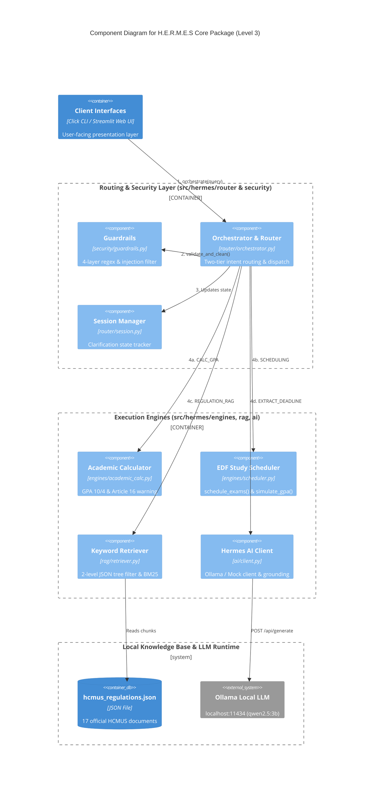

# C4 Model – Level 3: Component Diagram (`C4Component`)

---

## Giải thích kiến trúc Level 3 (Component Diagram)

**Mục đích:** Phóng to vào kiến trúc mã nguồn bên trong package `src/hermes`, ánh xạ trực tiếp **1-1 với từng file Python** của các thành viên trong nhóm và thể hiện luồng gọi hàm theo thứ tự `1 -> 2 -> 3 -> 4`.

### Luồng thực thi chi tiết theo thứ tự bước:
1. **Bước `1. orchestrate(query)`:**
   - Từ `Client Interfaces` (`cli.py` hoặc `ui/app.py`), câu truy vấn của người dùng được truyền vào `router/orchestrator.py` (R1 phụ trách).
2. **Bước `2. validate_and_clean()`:**
   - Trước khi xử lý, `Orchestrator` gọi sang **`Guardrails` (`security/guardrails.py` – TV4 phụ trách)** để chạy bộ lọc bảo mật 4 lớp: giải mã obfuscation, chặn Prompt Injection, chặn XSS/SQLi và từ chối làm bài tập hộ (Academic Integrity).
3. **Bước `3. Updates state`:**
   - Nếu truy vấn hợp lệ, `Orchestrator` cập nhật trạng thái hội thoại qua **`Session Manager` (`router/session.py` – R1 phụ trách)** để kiểm tra xem người dùng đã cung cấp đủ thông tin (Khóa tuyển sinh K21–K25, Hệ Chuẩn/CLC) hay cần hỏi làm rõ (`CLARIFICATION_NEEDED`).
4. **Bước `4a / 4b / 4c / 4d` – Điều phối xuống 4 Component thực thi (`Execution Engines`):**
   - **`4a. CALC_GPA` $\rightarrow$ `Academic Calculator` (`engines/academic_calc.py` – TV2 phụ trách):** Quy đổi điểm hệ 10 sang hệ 4 theo Quyết định 1175/QĐ-KHTN và kiểm tra ngưỡng cảnh báo học vụ theo Điều 16.
   - **`4b. SCHEDULING` $\rightarrow$ `EDF Study Scheduler` (`engines/scheduler.py` – TV2 phụ trách):** Chạy thuật toán *Earliest Deadline First (EDF)* kết hợp trọng số tín chỉ/độ khó qua hàm `schedule_exams()` và mô phỏng điểm mục tiêu `simulate_gpa()`.
   - **`4c. REGULATION_RAG` $\rightarrow$ `Keyword Retriever` (`rag/retriever.py` – TV3 phụ trách):** Cắt tỉa cây JSON 2 tầng theo đối tượng sinh viên và chấm điểm BM25 trên file `hcmus_regulations.json`.
   - **`4d. EXTRACT_DEADLINE` $\rightarrow$ `Hermes AI Client` (`ai/client.py` – TV6 phụ trách):** Gọi `POST /api/generate` xuống `Ollama Local LLM` để trích xuất JSON (`subject`, `deadline`, `task_type`) và đối chiếu ngược lại văn bản gốc (`grounding verification`) để chống bịa đặt.