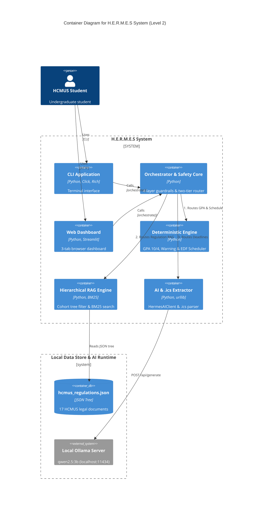

# C4 Model – Level 2: Container Diagram (`C4Container`)

---

## Giải thích kiến trúc Level 2 (Container Diagram)

**Mục đích:** Phóng to vào bên trong khối `H.E.R.M.E.S System` để thấy các **khối chức năng cấp cao (Containers)** và luồng dữ liệu đi từ giao diện người dùng xuống tầng xử lý và tầng lưu trữ.

### 1. Tầng Giao diện & Điều phối trung tâm (Hàng 1)
- **`CLI Application` (`src/hermes/cli.py`):** Giao diện dòng lệnh viết bằng `Click` và `Rich`, hỗ trợ các lệnh `ask`, `gpa`, `plan`, `interactive`.
- **`Web Dashboard` (`src/hermes/ui/app.py`):** Giao diện trình duyệt 3 tab viết bằng `Streamlit` dành cho sinh viên phổ thông.
- **`Orchestrator & Safety Core` (`src/hermes/router/orchestrator.py`):** Đặt ở trung tâm vì cả CLI lẫn Web UI đều gọi chung hàm `orchestrate()`. Khối này thực hiện lọc bảo mật 4 lớp và phân loại ý định (Intent Routing) để điều phối xuống 3 Engine chuyên biệt.

### 2. Tầng 3 Engine chuyên biệt (Hàng 2)
- **`Deterministic Engine`:** Xử lý 100% bằng công thức toán học và thuật toán tất định (tính GPA hệ 10/hệ 4, kiểm tra cảnh báo học vụ Điều 16, lập lịch ôn thi EDF). Không gọi AI để loại bỏ hoàn toàn hiện tượng ảo giác số học.
- **`Hierarchical RAG Engine`:** Xử lý tra cứu quy chế học vụ bằng cách lọc cây JSON phân cấp theo khóa/hệ đào tạo và xếp hạng bằng thuật toán BM25.
- **`AI & .ics Extractor`:** Bóc tách thông báo học vụ tự do (qua Ollama) hoặc phân tích file lịch `.ics` xuất từ Moodle.

### 3. Tầng Dữ liệu & AI Runtime (`Local Data Store & AI Runtime`)
- **`hcmus_regulations.json` (`data/regulations/hcmus_regulations.json`):** Kho tri thức JSON cấu trúc cây gồm 17 văn bản pháp quy chính thức của Trường ĐH KHTN.
- **`Local Ollama Server`:** Nhận request `POST /api/generate` từ khối `AI & .ics Extractor`.