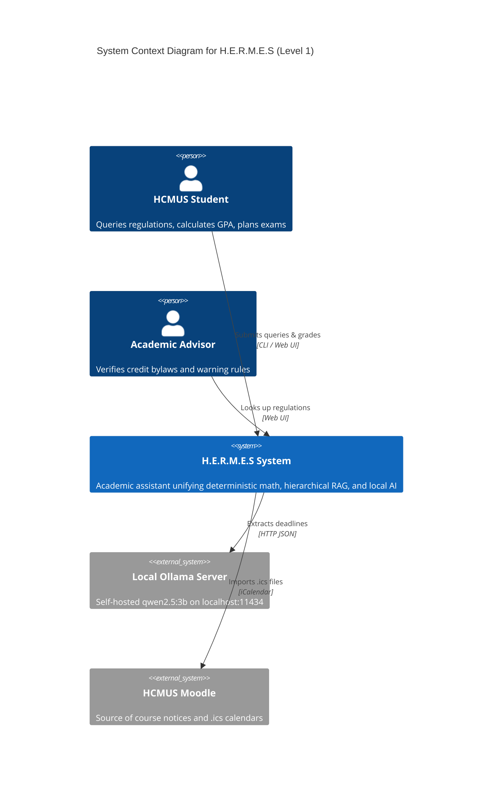

# C4 Model – Level 1: System Context Diagram (`C4Context`)

---

## Giải thích kiến trúc Level 1 (System Context)

**Mục đích:** Xác định **ranh giới hệ thống (System Boundary)**, đối tượng người dùng và các hệ thống bên ngoài mà H.E.R.M.E.S tương tác.

### 1. Các tác nhân con người (`Person`)
- **`HCMUS Student` (Sinh viên Trường ĐH KHTN):** Người dùng chính — gửi câu hỏi quy chế học vụ, nhập bảng điểm để tính GPA/cảnh báo học vụ, và lập lịch ôn thi qua CLI hoặc Web UI.
- **`Academic Advisor` (Cố vấn học tập):** Người dùng phụ — tra cứu nhanh điều khoản tín chỉ, chuẩn đầu ra ngoại ngữ và ngưỡng cảnh báo học vụ cho từng khóa (K21–K25).

### 2. Hệ thống trung tâm (`Software System`)
- **`H.E.R.M.E.S System`:** Hệ thống trợ lý học vụ lai (*Hybrid Deterministic–AI*), kết hợp tính toán tất định, tra cứu quy chế phân cấp (Hierarchical RAG) và AI cục bộ.

### 3. Hệ thống ngoại vi (`System_Ext`)
- **`Local Ollama Server` (`localhost:11434`):** Máy chủ LLM chạy cục bộ mô hình mã nguồn mở `qwen2.5:3b` qua giao thức `HTTP JSON`, đảm bảo chi phí API bằng 0 và không rò rỉ dữ liệu sinh viên lên đám mây.
- **`HCMUS Moodle`:** Hệ thống LMS của trường, nơi sinh viên lấy thông báo môn học hoặc xuất file lịch `.ics` (`iCalendar`) để đưa vào H.E.R.M.E.S trích xuất hạn nộp bài.